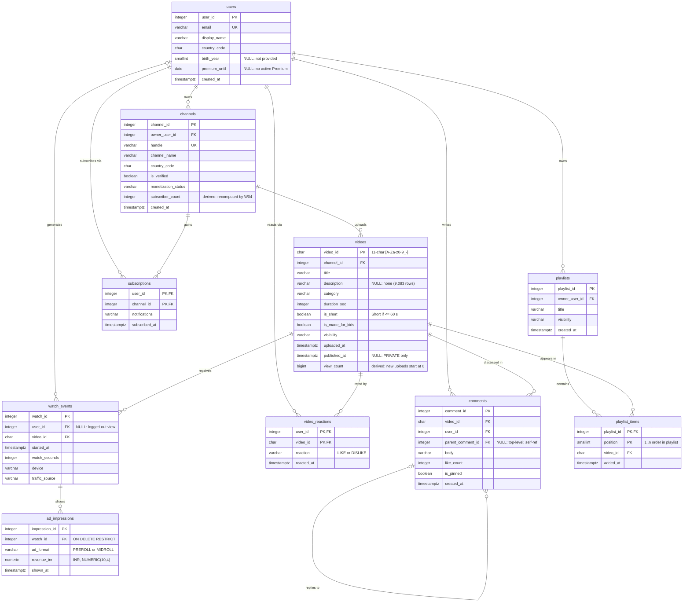

# Phase 2 — Schema Design

**Status: `sql/01_schema.sql` runs top to bottom on an empty database, `sql/02_load_data.sql` loads all 10 CSV files without a single error, and all 30 workload queries (R01 to R25, plus W01 to W05 inside `BEGIN ... ROLLBACK`) run successfully against the loaded data.**

## 1. How we worked

Nobody gave us the `CREATE TABLE` statements. Working them out was the actual task. Here is what we did, step by step:

1. We looked at every CSV file first: headers, row counts, which columns have empty values, distinct values, minimum and maximum. Only after that did we write any DDL.
2. We searched for candidate keys. We checked whether `user_id`/`email`, `handle`, `(user_id, channel_id)`, `(user_id, video_id)`, `(playlist_id, position)` and `(playlist_id, video_id)` are unique across the full files. Where they were unique, they became keys.
3. We checked that every id in a child file (user_id, channel_id, video_id, watch_id, parent_comment_id) actually exists in the parent file. This is how we knew the foreign keys would hold.
4. We tested our business rules against all rows. Only rules that accept 100% of the seed data went into the schema. One rule we expected turned out to be broken in the data itself (see section 9).
5. We loaded the data for real and re-ran everything after each schema change, including a smoke run of all 30 workload queries.

Two type decisions we applied everywhere: all timestamps in the export carry `+05:30` offsets, so every time column is `TIMESTAMPTZ` (timestamp with time zone). All money is `NUMERIC`, never float, because float arithmetic can be off by tiny amounts and money needs to be exact. Yes/no columns are `BOOLEAN`, country codes are `CHAR(2)`, birth year is `SMALLINT`.

## 2. Rules compliance

- Every table lives in the schema `youtube` (`CREATE SCHEMA youtube; SET search_path TO youtube;`).
- Phase 2 allows only constraints: PK, FK, UNIQUE, NOT NULL, CHECK. No tuning indexes yet. Those belong to Phase 4. The indexes PostgreSQL creates automatically for PK and UNIQUE are listed in section 11.
- The schema has 27 CHECK constraints (12 of them the required ones), 10 primary keys, 11 foreign keys and 2 natural UNIQUE keys.
- `01_schema.sql` can be run again from scratch: it starts with `DROP SCHEMA IF EXISTS youtube CASCADE`.

## 3. Data dictionary

### 3.1 `users`: 30,000 rows

| Column | Type | Constraints | Reasoning |
|---|---|---|---|
| user_id | INTEGER | PK | Id from the export. Plain INTEGER is enough: 30,000 rows now, 600,000 at 20x growth, both fit easily. |
| email | VARCHAR(255) | NOT NULL, UNIQUE | This is how people log in. We checked it is unique across all 30,000 rows. |
| display_name | VARCHAR(100) | NOT NULL | Always present in the export. Not unique: only 500 distinct names exist. |
| country_code | CHAR(2) | NOT NULL, CHECK `~ '^[A-Z]{2}$'` | ISO country code, two uppercase letters. Values in data: AE, GB, IN, SG, US. |
| birth_year | SMALLINT | NULL allowed, CHECK 1900–2013 | Empty in 4,433 rows, so age is optional. The range says nobody is born before 1900, and 2013 or earlier means at least about 13 years old in 2026 (a COPPA-style rule). Actual data: 1960 to 2009. |
| premium_until | DATE | NULL allowed, CHECK >= signup date | Empty in 27,602 rows, meaning no active Premium. R25 compares this to `shown_at::date`, so DATE is the right type. |
| created_at | TIMESTAMPTZ | NOT NULL | Account creation time, always present. |

### 3.2 `channels`: 3,000 rows

| Column | Type | Constraints | Reasoning |
|---|---|---|---|
| channel_id | INTEGER | PK | Id from the export. |
| owner_user_id | INTEGER | NOT NULL, FK -> users, ON DELETE CASCADE | A channel cannot exist without its owner, so it dies with the owner. |
| handle | VARCHAR(30) | NOT NULL, UNIQUE, CHECK `~ '^@[A-Za-z0-9._-]+$'` | The natural key, like `@vivaanvlogs1`. Checked unique. |
| channel_name | VARCHAR(100) | NOT NULL | Display name. 200 distinct names, so not unique. |
| country_code | CHAR(2) | NOT NULL, CHECK `~ '^[A-Z]{2}$'` | Same format rule as users. Values in data: GB, IN, US. |
| is_verified | BOOLEAN | NOT NULL | The export uses t/f, which is exactly a boolean. |
| monetization_status | VARCHAR(15) | NOT NULL, CHECK IN (NOT_ELIGIBLE, ELIGIBLE, SUSPENDED) | These are the three values present in the data. |
| subscriber_count | INTEGER | NOT NULL, CHECK >= 0 | A kept-up-to-date counter (see section 7). |
| created_at | TIMESTAMPTZ | NOT NULL | Channel creation time. |

One thing we deliberately did NOT constrain: `owner_user_id` is not UNIQUE. In this export each user owns at most one channel (3,000 channels, 3,000 distinct owners, so currently 1:1). But YouTube lets one account run several channels, so we only enforce "each channel has exactly one owner".

### 3.3 `videos`: 30,000 rows

| Column | Type | Constraints | Reasoning |
|---|---|---|---|
| video_id | CHAR(11) | PK, CHECK `~ '^[A-Za-z0-9_-]{11}$'` | The 11-character YouTube id alphabet. Verified on all rows, e.g. `ZkNSlUB1EOs` and `__21WjTDc9K`. |
| channel_id | INTEGER | NOT NULL, FK -> channels, ON DELETE CASCADE | Videos belong to their channel and are deleted with it. |
| title | VARCHAR(100) | NOT NULL | YouTube caps titles at 100 chars. Longest in data is 37. |
| description | VARCHAR(5000) | NULL allowed | Empty for 9,083 videos, so description is optional. |
| category | VARCHAR(20) | NOT NULL, CHECK IN (10 values) | Comedy, Cooking, Education, Film, Gaming, Music, News, Sports, Tech, Vlogs. |
| duration_sec | INTEGER | NOT NULL, CHECK > 0 | Positive length in seconds. Also protects R09, which divides by duration. Range: 10 to 3,718 seconds. |
| is_short | BOOLEAN | NOT NULL | See section 7. It can be derived from duration, but we keep the explicit flag. |
| is_made_for_kids | BOOLEAN | NOT NULL DEFAULT FALSE | Set at upload. The DEFAULT matters: workload insert W01 does not mention this column, and without a default the insert would fail. |
| visibility | VARCHAR(10) | NOT NULL, CHECK IN (PUBLIC, UNLISTED, PRIVATE, SCHEDULED) | Counts: 26,335 / 2,079 / 1,526 / 60. |
| uploaded_at | TIMESTAMPTZ | NOT NULL | When the file was uploaded. |
| published_at | TIMESTAMPTZ | NULL allowed + 2 CHECKs (below) | NULL exactly for the 1,526 PRIVATE videos. Every UNLISTED, PUBLIC or SCHEDULED video has a value. SCHEDULED rows store the future go-live time (2 to 21 July 2026). |
| view_count | BIGINT | NOT NULL DEFAULT 0, CHECK >= 0 | A kept-up-to-date counter (section 7). BIGINT because view counts grow without bound. The DEFAULT keeps W01 legal. |

Three column-pair rules on top: `videos_private_never_published` (PRIVATE means `published_at IS NULL`), `videos_scheduled_needs_publish_time` (SCHEDULED means `published_at IS NOT NULL`), and `videos_published_not_before_upload` (`published_at >= uploaded_at`, 0 violations in 30,000 rows).

### 3.4 `subscriptions`: 129,253 rows

| Column | Type | Constraints | Reasoning |
|---|---|---|---|
| user_id | INTEGER | PK (part 1), FK -> users, CASCADE | Composite PK. One subscription per (user, channel), checked: no duplicates in the file. |
| channel_id | INTEGER | PK (part 2), FK -> channels, CASCADE | |
| notifications | VARCHAR(12) | NOT NULL, CHECK IN (NONE, PERSONALIZED, ALL) | The three values in the data. |
| subscribed_at | TIMESTAMPTZ | NOT NULL | When the subscription happened. |

### 3.5 `watch_events`: 200,000 rows (the main fact table)

| Column | Type | Constraints | Reasoning |
|---|---|---|---|
| watch_id | INTEGER | PK | Plain INTEGER, not GENERATED, because workload W02 inserts explicit ids (90000001). |
| user_id | INTEGER | NULL allowed, FK -> users, ON DELETE CASCADE | NULL in 49,964 rows (25.0%). That means a logged-out view. We chose CASCADE, not SET NULL: if we set deleted users' views to NULL, they would count as "logged out" and quietly change the numbers in R12. Deleting the history is more honest. |
| video_id | CHAR(11) | NOT NULL, FK -> videos, CASCADE | The video that was watched. |
| started_at | TIMESTAMPTZ | NOT NULL | Range: 2025-01-01 to 2026-06-30. |
| watch_seconds | INTEGER | NOT NULL, CHECK 0–86400 | 0 means clicked away instantly (458 rows). 86400 caps it at one day. Max in data: 3,718. |
| device | VARCHAR(10) | NOT NULL, CHECK IN (WEB, ANDROID, IOS, TV) | The four devices in the data. |
| traffic_source | VARCHAR(15) | NOT NULL, CHECK IN (6 values) | HOME, SEARCH, SUGGESTED, SHORTS_FEED, SUBSCRIPTION, EXTERNAL. |

### 3.6 `video_reactions`: 67,417 rows

| Column | Type | Constraints | Reasoning |
|---|---|---|---|
| user_id | INTEGER | PK (part 1), FK -> users, CASCADE | Composite PK. At most one reaction per user per video, checked. |
| video_id | CHAR(11) | PK (part 2), FK -> videos, CASCADE | |
| reaction | VARCHAR(7) | NOT NULL, CHECK IN (LIKE, DISLIKE) | |
| reacted_at | TIMESTAMPTZ | NOT NULL | |

### 3.7 `comments`: 60,000 rows

| Column | Type | Constraints | Reasoning |
|---|---|---|---|
| comment_id | INTEGER | PK | Id from the export. |
| video_id | CHAR(11) | NOT NULL, FK -> videos, CASCADE | The video the comment is on. |
| user_id | INTEGER | NOT NULL, FK -> users, CASCADE | Who wrote it. |
| parent_comment_id | INTEGER | NULL allowed, FK -> comments (self), CASCADE | NULL in 52,610 rows means a top-level comment. 7,390 rows are replies. Deleting a comment cascades to its replies, which matches how YouTube deletes a whole thread. We also checked that every reply points to a parent with a smaller comment_id, so the file is parent-before-child and the FK check works immediately. |
| body | VARCHAR(10000) | NOT NULL | YouTube's comment length cap. |
| like_count | INTEGER | NOT NULL, CHECK >= 0 | 0 to 1,999 in the data. |
| is_pinned | BOOLEAN | NOT NULL | |
| created_at | TIMESTAMPTZ | NOT NULL | |

One extra rule: `comments_replies_cannot_be_pinned` (`parent_comment_id IS NULL OR NOT is_pinned`). Only top-level comments can be pinned. 0 violations in the data.

### 3.8 `playlists`: 8,000 rows

| Column | Type | Constraints | Reasoning |
|---|---|---|---|
| playlist_id | INTEGER | PK | Id from the export. |
| owner_user_id | INTEGER | NOT NULL, FK -> users, CASCADE | Playlist owner. |
| title | VARCHAR(150) | NOT NULL | YouTube's playlist title cap. |
| visibility | VARCHAR(10) | NOT NULL, CHECK IN (PRIVATE, UNLISTED, PUBLIC) | The three values in the data. |
| created_at | TIMESTAMPTZ | NOT NULL | |

### 3.9 `playlist_items`: 56,005 rows

| Column | Type | Constraints | Reasoning |
|---|---|---|---|
| playlist_id | INTEGER | PK (part 1), FK -> playlists, CASCADE | Composite PK with position. Each position is used once per playlist. Checked: positions run 1 to 12 and are contiguous from 1 in every playlist. |
| position | SMALLINT | PK (part 2), CHECK >= 1 | SMALLINT is plenty for a position inside one playlist. |
| video_id | CHAR(11) | NOT NULL, FK -> videos, CASCADE | The video sitting at this position. |
| added_at | TIMESTAMPTZ | NOT NULL | When it was added. Never before the playlist was created, checked. |

We deliberately did NOT make `(playlist_id, video_id)` unique. YouTube legitimately allows the same video twice in one playlist. The seed data happens to contain no such duplicate (integrity check IC3), but that is a property of this export, not a business rule.

### 3.10 `ad_impressions`: 57,014 rows

| Column | Type | Constraints | Reasoning |
|---|---|---|---|
| impression_id | INTEGER | PK | Id from the export. |
| watch_id | INTEGER | NOT NULL, FK -> watch_events, ON DELETE RESTRICT | An ad impression is a financial record. RESTRICT means you cannot delete a watch event that carries ad revenue. See section 4. |
| ad_format | VARCHAR(10) | NOT NULL, CHECK IN (PREROLL, MIDROLL) | The two formats in the data. |
| revenue_inr | NUMERIC(10,4) | NOT NULL, CHECK >= 0 | Money. Exact decimal with 4 decimal places, as exported. Range 0.1750 to 0.8250 rupees. |
| shown_at | TIMESTAMPTZ | NOT NULL | When the ad ran. Always inside the watch event's own time window (IC4). |

## 4. Relationships and the delete policy

The main question for each relationship is: when the parent row is deleted, what happens to the child rows?

| Relationship | Cardinality | ON DELETE | Reasoning |
|---|---|---|---|
| users -> channels (owner) | 1:N (1:1 in this data) | CASCADE | A channel cannot exist without its owner. |
| channels -> videos | 1:N (one channel in the export has no videos) | CASCADE | Videos die with their channel. |
| users <-> channels via subscriptions | M:N | CASCADE both | An engagement record is meaningless if either side is gone. |
| users -> watch_events.user_id | 0:N, optional on the event side | CASCADE (not SET NULL) | SET NULL would turn a deleted user's views into "logged out" views and corrupt R12's numbers. Deleting the history keeps the metric honest. |
| videos -> watch_events | 1:N | CASCADE | Watch events of a deleted video are meaningless. |
| watch_events -> ad_impressions | 1:N | RESTRICT | Financial records must never be silently destroyed. An account or video that earned ad revenue cannot be hard-deleted until its impressions are explicitly archived. |
| users/videos -> video_reactions | M:N | CASCADE both | Engagement record. |
| users/videos -> comments; comments -> replies | M:N / self 1:N | CASCADE | Deleting a comment deletes its thread, like YouTube. |
| users -> playlists -> playlist_items; videos -> playlist_items | 1:N chains | CASCADE | A playlist dies with its owner; items die with the playlist or the video. |

The one interesting choice is RESTRICT on ad_impressions. Everything engagement-related cascades, because engagement data has no meaning without its parent. Money is different: if a channel earned 500 rupees of ad revenue and then gets deleted, finance still needs that record. RESTRICT forces us to archive the money records first. That is the right trade for a financial system.

## 5. ER diagram

Image: [`diagrams/er_diagram.png`](../diagrams/er_diagram.png) (crow's-foot notation, PK/FK/UK marked per attribute).



## 6. Functional dependencies and normal form

Notation: `X -> Y` reads "X determines Y", meaning if you know X you also know Y.

A table is in 3NF if every non-key column depends on the key, the whole key, and nothing but the key. It is in BCNF if, for every dependency X -> Y, X is a key of the table (a superkey, strictly). BCNF is the stricter version. We checked every table for both.

**users.** `user_id -> (email, display_name, country_code, birth_year, premium_until, created_at)` and `email -> user_id` because email is unique. Both sides of each rule are keys, so no violation. 3NF and BCNF.

**channels.** `channel_id -> (owner_user_id, handle, ...)` and `handle -> channel_id` because handle is unique. No dependency between non-key columns exists. 3NF and BCNF.

**videos.** `video_id -> (channel_id, title, ...)`. Something like `channel_id -> channel_name` does not exist here because channel_name lives in the channels table, so there is no chain through a non-key column. 3NF and BCNF. `is_short` and `view_count` are derived values we keep on purpose, not dependencies (section 7).

**subscriptions.** Key is `(user_id, channel_id)`. `subscribed_at` and `notifications` depend on the pair. You cannot know when user X subscribed to channel Y from X alone or from Y alone, so they depend on the whole key. No partial dependency, no transitive one. 3NF and BCNF.

**watch_events.** `watch_id -> (user_id, video_id, started_at, ...)`. The time of a view belongs to the view event, not to the user or the video alone. 3NF and BCNF.

**video_reactions.** Key is `(user_id, video_id)`. `reaction` and `reacted_at` depend on the pair. 3NF and BCNF.

**comments.** `comment_id -> (video_id, user_id, parent_comment_id, ...)`. One row describes one comment. 3NF and BCNF.

**playlists.** `playlist_id -> (owner_user_id, title, visibility, created_at)`. 3NF and BCNF.

**playlist_items.** Key is `(playlist_id, position)`. `video_id` and `added_at` depend on the pair. The same video in two different playlists is two different rows. 3NF and BCNF.

**ad_impressions.** `impression_id -> (watch_id, ad_format, revenue_inr, shown_at)`. Revenue depends on the impression, not on the watch alone. One watch can carry a PREROLL and a MIDROLL with different revenue, so they must be separate rows. 3NF and BCNF.

## 7. Derived columns we keep on purpose

These columns break the "no redundancy" idea in a small way. We keep each one because it saves a lot of work at read time, and we say so openly:

| Column | What it is derived from | Why we keep it |
|---|---|---|
| `channels.subscriber_count` | `count(*)` over subscriptions per channel | W04 recomputes it nightly. A channel page (R02) then reads one number instead of counting up to about 5,000 subscription rows. Checked consistent with the export (IC7: 0 mismatches). |
| `videos.view_count` | `count(*)` over watch_events per video | W03 adds one every time a view is recorded. Same trade-off as above. Checked consistent (IC6). Between refreshes the counter can drift slightly from the true count; we accept that and document it. |
| `videos.is_short` | `duration_sec <= 60` | The flag is exactly `duration_sec <= 60` in all 30,000 rows. Keeping the explicit boolean records what the creator chose. We constrain only one direction (a Short must be 60 seconds or less), not the reverse, so the rule survives if YouTube ever changes the Shorts limit. |

## 8. Load results (real run)

```bash
createdb youtube
psql -d youtube -f sql/01_schema.sql          # runs clean
psql -d youtube -f sql/02_load_data.sql       # from the repo root; ~6 s, no errors
```

Output of the row-count check at the end of `02_load_data.sql`:

```
table_name       | rows_loaded
-----------------+-------------
ad_impressions   |       57014
channels         |        3000
comments         |       60000
playlist_items   |       56005
playlists         |        8000
subscriptions    |      129253
users            |       30000
video_reactions  |       67417
videos           |       30000
watch_events     |      200000
```

All ten counts match the project brief exactly. Every constraint accepted every row. Not one row was rejected or modified during load.

## 9. Integrity checks (real output)

All run after `SET search_path TO youtube;` on the loaded database.

**IC1: Nobody watched a video before it was uploaded**

```sql
SELECT count(*) AS violations
FROM watch_events w JOIN videos v USING (video_id)
WHERE w.started_at < v.uploaded_at;
```
```
violations
-----------
         0
```

**IC2: `watch_seconds` never exceeds the video duration.** This spans two tables, so it cannot be a CHECK constraint (CHECKs only see one row of one table). It has to be a query.

```sql
SELECT count(*) AS violations
FROM watch_events w JOIN videos v USING (video_id)
WHERE w.watch_seconds > v.duration_sec;
```
```
violations
-----------
         0
```

**IC3: No playlist contains the same video twice**

```sql
SELECT count(*) AS playlists_with_duplicates
FROM (SELECT playlist_id FROM playlist_items
      GROUP BY playlist_id, video_id HAVING count(*) > 1) t;
```
```
playlists_with_duplicates
-------------------------
                        0
```

**IC4: Every ad was shown during its own watch event** (between `started_at` and `started_at + watch_seconds`)

```sql
SELECT count(*) AS violations
FROM ad_impressions a JOIN watch_events w USING (watch_id)
WHERE a.shown_at < w.started_at
   OR a.shown_at > w.started_at + make_interval(secs => w.watch_seconds);
```
```
violations
-----------
         0
```

**IC5: Ads shown to users with an active Premium membership.** The business rule says Premium users never see ads.

```sql
SELECT count(*) AS premium_ad_violations
FROM ad_impressions a
JOIN watch_events w USING (watch_id)
JOIN users u ON u.user_id = w.user_id
WHERE u.premium_until >= a.shown_at::date;
```
```
premium_ad_violations
----------------------
                  181
```

This one is not zero. 181 rows are real data-quality violations, and this is exactly what audit query R25 finds. We deliberately did not add a constraint to block them. If we did, the load would reject those rows and the audit query would have nothing to find. The rows have to be in the database so the audit can catch them. The fix belongs in the ad-serving code, not in the schema.

**IC6: `videos.view_count` matches the actual watch-event counts**

```sql
SELECT count(*) AS mismatched_videos
FROM videos v
LEFT JOIN (SELECT video_id, count(*) n FROM watch_events GROUP BY video_id) w USING (video_id)
WHERE v.view_count <> coalesce(w.n, 0);
```
```
mismatched_videos
-------------------
                 0
```

**IC7: `channels.subscriber_count` matches the actual subscription counts**

```sql
SELECT count(*) AS mismatched_channels
FROM channels c
LEFT JOIN (SELECT channel_id, count(*) n FROM subscriptions GROUP BY channel_id) s USING (channel_id)
WHERE c.subscriber_count <> coalesce(s.n, 0);
```
```
mismatched_channels
---------------------
                   0
```

**IC8: No reply was posted before the comment it replies to**

```sql
SELECT count(*) AS violations
FROM comments r JOIN comments p ON p.comment_id = r.parent_comment_id
WHERE r.created_at < p.created_at;
```
```
violations
-----------
         0
```

**Workload smoke test.** After loading, we ran all 30 queries from `queries/workload_30.sql` (writes inside `BEGIN ... ROLLBACK`): 30 out of 30 succeeded. That includes R19, the deliberately heavy one (about 17 s at this scale), and R13, which returns 0 rows. R13 returning nothing is the P5 trap (`NOT IN` with NULLs), explained and fixed in Phase 4.

## 10. Data problems and notable findings

1. **Premium members saw ads, 181 times (IC5 / R25).** The clearest genuine data problem in the export. We left the rows in on purpose, for the reason above.
2. **R13 returns an empty report even though such subscribers exist.** Not a schema problem. `NOT IN` over a subquery that produces NULLs filters everything out. Identified here, fixed in Phase 4.
3. **Workload W01 failed on our first run.** It inserts a video without `is_made_for_kids` or `view_count`. The spec says fix the schema, not the query, so both columns got defaults (FALSE and 0). A new upload genuinely starts with zero views, so the default is also the business-correct value.
4. **Users to channels is 1:1 in this export** (3,000 distinct owners for 3,000 channels) but the business allows more. Documented, not constrained.
5. **Two users subscribe to their own channel.** Legal on YouTube, kept.
6. **25% of watch events are logged-out** (`user_id IS NULL`). By design. It drives R12 and is why `watch_events.user_id` is nullable.
7. **Engagement never touches PRIVATE videos.** No reactions, comments or playlist placements reference the 1,526 private videos. The platform's own behavior, working as intended.
8. **`is_short` is exactly `duration_sec <= 60` in this export** (longest Short: 59 s, shortest regular video: 61 s). We constrain only the business direction (section 7).

## 11. Automatic index inventory (Phase 2)

No tuning indexes exist yet. PostgreSQL creates backing indexes automatically for every PRIMARY KEY and UNIQUE constraint, so we start with exactly these:

```
ad_impressions_pkey   ON ad_impressions (impression_id)
channels_handle_key   ON channels (handle)
channels_pkey         ON channels (channel_id)
comments_pkey         ON comments (comment_id)
playlist_items_pkey   ON playlist_items (playlist_id, position)
playlists_pkey        ON playlists (playlist_id)
subscriptions_pkey    ON subscriptions (user_id, channel_id)
users_email_key       ON users (email)
users_pkey            ON users (user_id)
video_reactions_pkey  ON video_reactions (user_id, video_id)
videos_pkey           ON videos (video_id)
watch_events_pkey     ON watch_events (watch_id)
```

Why this matters for Phase 3: these indexes only answer questions of the form "give me the row with this key". Any lookup by something else, like R01's `channel_id`, R05's `user_id` or R08's `video_id`, cannot use them. Those lookups will read the whole table. That is exactly the untuned baseline we are supposed to measure next.

## 12. How to reproduce

```bash
# from the repository root, with seed_data/ unzipped next to this README
createdb youtube
psql -d youtube -f sql/01_schema.sql
psql -d youtube -f sql/02_load_data.sql     # prints the row-count table at the end
psql -d youtube -c "SET search_path TO youtube; <any IC query from section 9>"
```
